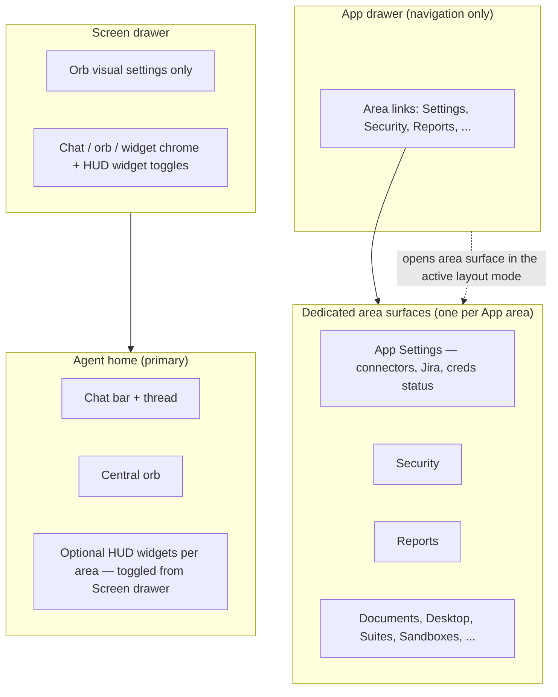

# KAN-102 CR — Desktop nav, agent widgets, App vs Orb settings

**Status:** Product model locked (2026-11-15). **Navigation chrome locked 2026-11-16 as configurable A–E** (not a single mockup): `overlay`, `stage`, `orb_hub`, `split`, `floating` in App Settings (`desktop-area-layout-v1`). Area chrome uses the active orb-style accent (FR-UI-3). **Active slice = KAN-103** (KAN-75 deferred). Hub particles and richer HUD widgets are still open.

**Canonical spec:** `docs/FUNCTIONAL_SPEC.md` — FR-UI-1/3/6/7, FR-SET-3.

**Jira:** Bug **KAN-102** | Story **KAN-103** (epic KAN-27) | test **KAN-104** | Tasks **KAN-106** (area screens), **KAN-107** (HUD widgets), **KAN-108** (App vs Orb settings), **KAN-109** (orb hub later), **KAN-110** (KAN-101 overlap). Duplicate Story **KAN-105** — cancelled; use KAN-103 only.

---

## Product model

| Concept | Where it lives | Not here |
|--------|----------------|----------|
| Agent conversation + orb | Agent home | App drawer inline sections |
| HUD status / mini panels | Agent home, toggles in Screen drawer | App → Settings list |
| Orb style, size, spin, colours | Screen drawer | App → Settings |
| Jira URL, connectors, app-wide config, **App area layout** | App → Settings **area screen** | Screen drawer orb sliders |
| Security, Reports, etc. | Each own **area screen** | Inline `app-section-*` in drawer |

**Layout modes (all shipped as a setting):** overlay (A), stage (B), orb hub spokes then overlay (C, simple radial — particle polish later), split dock (D), one floating window (E). Accents follow mystic / aether / neural / apex.

**Still open:** richer HUD widgets; particle hub; multiple floating areas.

---

## Phased slices (Jira)

| Phase | Jira | Scope |
|-------|------|--------|
| 1 | **Task:** Area screens routing | Replace inline `app-section-*` swap with dedicated surfaces for all App nav items |
| 2 | **Task:** HUD widgets | FR-UI-6 toggles in Screen drawer; widgets on home canvas |
| 3 | **Task:** Settings split | FR-SET-3 — App Settings screen vs Orb settings in Screen drawer |
| 4 | **Task:** KAN-101 | Drawer toggle vs Settings nav overlap with new chrome |
| 5 | **Task (later):** Orb hub | Optional particle launcher — spike / flag only |
| Verify | **`test`** ticket (Relates → Story) | Computer Use + pytest checklist below |

---

## Files likely touched (developer)

- `ui/desktop/index.html` — structure: home vs area routes; remove inline section pattern as primary UX
- `ui/desktop/desktop.js` — routing/state; widget toggles; drawer behaviour
- `ui/desktop/desktop.css` — full-window area layout; z-index with drawers
- `desktop_app.py` — cache-bust if static assets change
- `main.py` / settings APIs — only if App Settings surface needs new endpoints (prefer reuse `/api/app-settings`, etc.)
- `tests/` — optional DOM/routing unit tests if extracted

**Reference (current defect):** App drawer swaps inline sections (KAN-102). KAN-73 shipped Settings **content** but in the wrong shell pattern until area screens land.

---

## Out of scope (this epic’s first pass)

- Gradio parity for every area screen
- Voice (KAN-81)
- Orb hub particle navigation (separate lower-priority Task)
- New backend features beyond wiring existing APIs into area screens

---

## Developer verification checklist

1. Run `.\venv\Scripts\python.exe desktop_app.py`.
2. Agent home: chat + orb visible; no App area renders as inline drawer expansion on home.
3. Screen drawer: toggling a HUD widget shows/hides it on home; orb settings still only here.
4. App drawer: each nav item opens a **dedicated surface** (not inline list expansion).
5. App → Settings: Jira URL / credential status / connectors — **no** orb style sliders.
6. Regression: existing Security, Reports, Suites areas still reachable after routing change.

---

## Tester verification checklist (`test` ticket)

1. **Computer Use** on native desktop window (not browser tab of `/ui/desktop/`).
2. Capture screenshots: home + one area screen + Screen drawer toggles + App Settings.
3. Run `.\venv\Scripts\python.exe -m pytest tests/test_app_settings.py -v` if App Settings routing touched store/API.
4. Confirm **KAN-101** replication steps no longer reproduce (or document remaining gap as new Bug).
5. Post evidence on linked `test` ticket before Story Done.

---

## PM notes

- **Active slice (2026-11-16):** **KAN-103** — A–E layout setting is in the desktop shell. **KAN-75** stays deferred. Mockups: `docs/mockups/kan103_nav/README.md`.
- KAN-73 **Done** delivered Settings **behaviour**; this Story delivers correct **navigation shell** per CR.